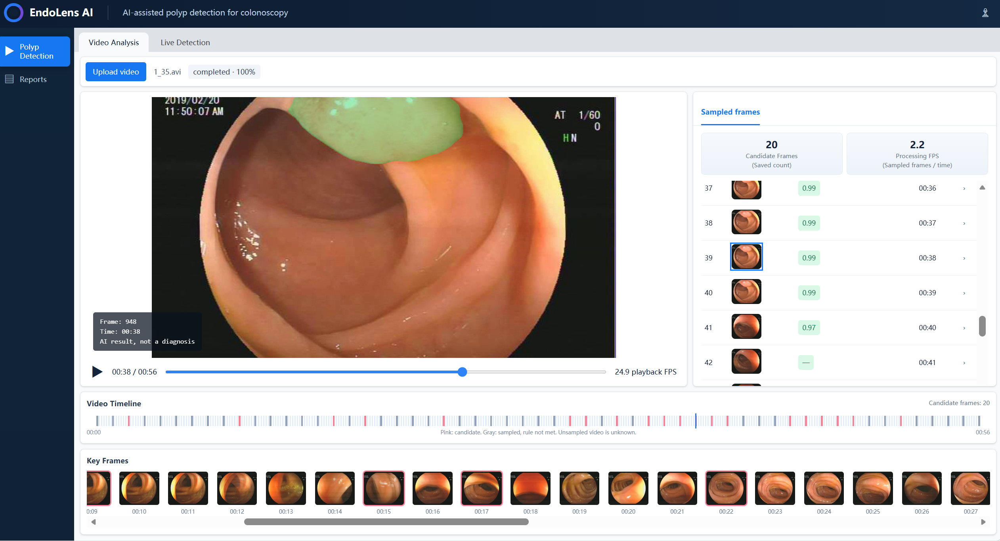

<div align="center">

<h1>EndoLens AI</h1>
<p><strong>Polyp Segmentation and Colonoscopy Video Analysis</strong></p>

<p></p>

<p>National University of Singapore<br>Institute of Systems Science (NUS-ISS)</p>
<p>Practice Module (ISY5002) · Practice Project Group (FT) 8</p>

<p><strong>Project Team</strong><br>
Zhang Tianqin · A0356380B<br>
Zhang Yuyue · A0305487X<br>
Ma Jialing · A0305478X<br>
Gong Yucheng · A0355325E</p>

</div>

---

## Section 1: Project Overview

EndoLens AI connects AI-based polyp segmentation with video processing, visual inspection, and saved analysis reports. The project is motivated by missed polyps during colonoscopy and focuses on presenting predicted regions clearly within their original video context.

The application supports two complementary workflows: **Recorded-Video Analysis** for inspecting uploaded recordings and **Simulated-Live Analysis** for receiving predictions during playback. For demonstration purposes, a pre-recorded video simulates the incoming colonoscopy video stream.

### Core Features

- **Recorded-video analysis:** upload a recording, monitor background processing, and inspect timestamped predictions.
- **Simulated-live annotation:** play a recording while individual captured frames are submitted for inference and displayed alongside the source playback.
- **Segmentation visualization:** show the filtered predicted mask on the exact analyzed frame. Empty predictions produce no polyp overlay.
- **Frame-level navigation:** move between sampled frames, candidate observations, timeline markers, and key-frame previews.
- **Persistent reports:** retain source frames, masks, timestamps, task status, and model-configuration metadata for subsequent inspection.
- **Downloads and exports:** download annotated candidate images and export CSV metadata from the interface; JSON metadata is also available through the backend API.
- **Runtime feedback:** display processing progress and analysis rate, with model time, round-trip time, and skipped-frame counts in Live Detection.
- **Task management:** cancel recorded analyses and retain results already completed when processing is interrupted.

A candidate is a frame with a nonempty filtered prediction. Candidate-frame counts describe observations, not distinct polyps.

## Section 2: Executive Summary and System Architecture

Colonoscopy video analysis requires more than a segmentation mask. Users need to understand which frame was analyzed, where the predicted region appears, when it occurred in the recording, and how to retrieve the same result later. EndoLens AI integrates these steps into one web application.

In Recorded-Video Analysis, the backend accepts an uploaded recording, prepares it for browser playback, indexes presentation timestamps, and decodes selected frames for segmentation. Processing runs in a background task while the frontend retrieves progress and completed results. The current interface uses a one-second sampling interval. Selecting an analyzed timestamp displays the stored source frame with its matching mask, preserving frame–mask alignment.

In Simulated-Live Analysis, the browser captures individual frames during playback and sends them to a single-frame inference endpoint. Only one browser request remains in flight at a time; new capture opportunities are skipped while the previous request is pending. Returned predictions are displayed incrementally, and frames associated with a live session are saved for the shared reporting workflow. This mode currently uses a pre-recorded input rather than a directly connected endoscope.

Both workflows use the same **ResNet50 U-Net** inference pipeline, combining four-rotation test-time augmentation with native-resolution mask restoration and connected-component score filtering. The video interface and saved reports use the same filtered predictions.

The modular architecture separates browser interaction, HTTP services, video decoding, model inference, and persistence. The frontend uses React, TypeScript, and Vite. The backend uses FastAPI and PyTorch, with PyAV/OpenCV for video and image processing. SQLite stores task and frame records, while local files retain videos, frames, masks, and exports.

### Architecture

```text
React / TypeScript frontend
    |
    | HTTP /api/v1/*
    v
FastAPI backend — one Uvicorn worker
    |
    +-- Recorded analysis: upload → timestamp indexing → sampled decoding
    |                      → background inference queue → saved results
    |
    +-- Simulated live: playback capture → single-frame request
    |                   → synchronous inference → immediate response
    |
    +-- Shared model: ResNet50 U-Net → rotate4 TTA → native mask filtering
    |
    +-- Shared persistence: SQLite records + local video/image assets
    |
    +-- Reports and exports: frame summaries, candidate previews, CSV / JSON
```

### Model Configuration

| Setting | Configuration |
|---|---|
| Model version | `e13-r50-joint-r94-r4-region080-v2` |
| Architecture | ResNet50 encoder and five-stage U-Net decoder with GroupNorm |
| Input | RGB image resized to 320 × 320; ImageNet normalization |
| Inference | FP32; rotations of 0°, 90°, 180°, and 270°; inverse-aligned logit averaging |
| Output processing | Native-resolution restoration; pixel threshold 0.5; 8-connected components; component mean score ≥ 0.8 |
| Candidate rule | The filtered mask contains at least one foreground pixel |
| Model contract | [`SystemCode/backend/model.json`](SystemCode/backend/model.json) |

## Section 3: Presentation Video

The EndoLens AI presentation video covers the project background, system architecture, segmentation model, software implementation, and application demonstration. The demonstration shows recorded-video review, timestamped mask inspection, candidate navigation, Reports, and Simulated-Live Analysis.

**Presentation video:** [Watch the final project presentation on YouTube](https://youtu.be/qXlUmzXPsoE).

## Section 4: User Guide — Installation and Startup

Follow these steps to install and run the application locally.

### 4.1 System Requirements

The walkthrough below targets Windows 10/11 with PowerShell; macOS differences are noted where they apply.

- Git and access to this repository
- Conda (Miniconda, Anaconda, or Miniforge); the backend uses Python 3.11
- Node.js 24.x and npm (Vite 8 requires Node.js ≥ 20.19 or ≥ 22.12 and fails on older versions)
- The deployment weight file `e13_resnet50_joint_seed42_epoch94.pt` (about 124 MiB; not tracked in Git and obtained separately)
- Optional: an NVIDIA GPU with a CUDA 12.8-capable driver. Without a GPU the backend falls back to CPU, which is noticeably slower.

**[Download the final E13 model weights from Google Drive](https://drive.google.com/drive/folders/12nddUWrat2Ih4sHpa4c8M-DuO76tDEKO).** The folder is readable by anyone with the link.

The original weight is 130,413,723 bytes (124.37 MiB). It is distributed as two lossless parts because the upload interface limits individual files to 100 MiB. Download **both** files with their original names:

| File | Bytes | Download |
|---|---:|---|
| `e13_resnet50_joint_seed42_epoch94.pt.part01` | 67,108,864 | [Part 1](https://drive.google.com/file/d/1pw_dTRumCR9gzV01QwTre7jnBrnS1EQF/view?usp=drivesdk) |
| `e13_resnet50_joint_seed42_epoch94.pt.part02` | 63,304,859 | [Part 2](https://drive.google.com/file/d/1jK8p2FNagEAzYvKJ5aNW9XcCnKJ6BESa/view?usp=drivesdk) |

Do not unzip the parts or load either part with PyTorch. Step 4.4 restores the unchanged `.pt` file and checks both part hashes and the complete SHA256. The SDK and installation tool are in [`SystemCode/model/endolens_e13`](SystemCode/model/endolens_e13/README.md). No model retraining or format conversion is involved.

No separate database server, external API key, or internet connection is needed at runtime; SQLite runs locally. Tasks, sampled frames, masks, reviews, and exports are stored in a local storage directory.

Setup order: clone → Python environment → weights placement and check → backend environment variables → backend (Terminal 1) → frontend (Terminal 2) → functional checks.

### 4.2 Clone the Repository and Set the Project Path

```powershell
git clone https://github.com/TianQinNus/AIS_EndoLensAI.git
cd AIS_EndoLensAI
$env:ENDOLENS_ROOT = (Get-Location).Path
```

On macOS, use `export ENDOLENS_ROOT="$PWD"`. If the repository is already cloned, enter its root directory and run only the last line. All paths below are quoted so that folders containing spaces work.

### 4.3 Create the Python Environment

```powershell
conda create -n endolens python=3.11 -y
conda activate endolens
cd "$env:ENDOLENS_ROOT\SystemCode"
```

Install PyTorch for your machine (choose one), then install the backend dependencies:

```powershell
# Windows + NVIDIA GPU (CUDA 12.8, matching the model reference environment)
python -m pip install torch==2.9.1 torchvision==0.24.1 --index-url https://download.pytorch.org/whl/cu128

# Windows / Linux, CPU only
python -m pip install torch==2.9.1 torchvision==0.24.1 --index-url https://download.pytorch.org/whl/cpu

# macOS
python -m pip install torch==2.9.1 torchvision==0.24.1
```

```powershell
python -m pip install -r backend/requirements.txt
python -m pip check
python -c "import torch; print(torch.__version__, 'CUDA:', torch.cuda.is_available())"
```

Expected: `No broken requirements found.`, and `CUDA: True` on GPU machines. The backend supports only the `auto`, `cpu`, and `cuda:0` devices; it does not use Apple MPS, so it runs on CPU on a Mac.

### 4.4 Place and Verify the Model Weights

The weight is excluded by `.gitignore`. Download both parts from the links in Step 4.1 into the same local folder. From the repository root, run:

```powershell
python SystemCode/model/endolens_e13/install_weights.py --parts-dir "$HOME/Downloads"
```

The installer validates each part and restores the complete weight in both the existing application backend and standalone SDK. It refuses an incorrect existing destination. To install only the application copy, append `--target backend`. On macOS/Linux, use the same Python command with the appropriate downloads folder.

If the complete original `.pt` is already available, use `--source "C:/path/to/e13_resnet50_joint_seed42_epoch94.pt"` instead of `--parts-dir`. Verify installed copies at any time with:

```powershell
python SystemCode/model/endolens_e13/install_weights.py --check
```

The existing application still loads its weight from:

```text
SystemCode/backend/weights/e13_resnet50_joint_seed42_epoch94.pt
```

Verify its hash, which must match `weights_sha256` in `SystemCode/backend/model.json`:

```powershell
(Get-FileHash "$env:ENDOLENS_ROOT\SystemCode\backend\weights\e13_resnet50_joint_seed42_epoch94.pt" -Algorithm SHA256).Hash.ToLower()
```

On macOS, use `shasum -a 256 "$ENDOLENS_ROOT/SystemCode/backend/weights/e13_resnet50_joint_seed42_epoch94.pt"`.

Expected output:

```text
dc6c9092baf68cf9e66264f632fae76642ff621282aaa7f65dbf8a899f168e68
```

The backend checks the hash again at startup and refuses to load a mismatched file (`Weight integrity check failed`). Keep the checkpoint filename unchanged.

### 4.5 Configure the Backend Environment Variables (One Time)

The backend reads its configuration from process environment variables; it does not load a `.env` file. [`backend/.env.example`](SystemCode/backend/.env.example) is a reference template only. Store the variables in the conda environment so that every `conda activate endolens` applies them:

```powershell
conda env config vars set -n endolens ENDO_DEVICE=auto ENDO_STORAGE_DIR=runtime_data ENDO_MIN_REGION_AREA_RATIO=0 ENDO_CORS_ORIGINS=http://localhost:5173,http://127.0.0.1:5173,http://localhost:3000
conda deactivate
conda activate endolens
conda env config vars list
```

- `ENDO_DEVICE`: `auto` uses `cuda:0` when available and CPU otherwise; set `cpu` or `cuda:0` to force a device.
- `ENDO_STORAGE_DIR=runtime_data`: relative to the directory from which the backend is started. When started from `SystemCode/` as in Step 4.6, data is written to `SystemCode/runtime_data/`, which is ignored by Git.
- `ENDO_MIN_REGION_AREA_RATIO` must be `0`. This release uses confidence filtering only, and a nonzero value stops the backend from starting.
- `ENDO_CORS_ORIGINS` must list the actual frontend origins; the wildcard `*` is rejected.

### 4.6 Start the Backend — Terminal 1

Keep this process running:

```powershell
cd "$env:ENDOLENS_ROOT\SystemCode"
conda activate endolens
python -m uvicorn backend.main:app --host 127.0.0.1 --port 8000 --workers 1
```

Wait for `Application startup complete.` The API is at `http://127.0.0.1:8000/api/v1`, with interactive documentation at `http://127.0.0.1:8000/docs`.

Start the backend from `SystemCode/`, because `backend` is imported as a Python package. Use exactly one worker: the background inference queue and local storage are designed for a single process.

### 4.7 Install and Start the Frontend — Terminal 2

Open a new terminal. `$env:ENDOLENS_ROOT` does not carry over, so replace the path with the actual repository location:

```powershell
cd "C:\path\to\AIS_EndoLensAI\SystemCode\frontend"
node --version
npm --version
npm ci
npm run build
npm run dev -- --host localhost --port 5173 --strictPort
```

`npm ci` installs the versions in the committed `package-lock.json`. `npm run build` checks TypeScript and the production build; it does not start a server.

Open `http://localhost:5173` and keep both terminals running. The frontend has no Vite proxy; it calls `VITE_API_BASE_URL` directly, which defaults to `http://127.0.0.1:8000/api/v1`, so no frontend `.env` file is needed for this local setup. Only if the backend address or port changes, copy [`frontend/.env.example`](SystemCode/frontend/.env.example) to `.env`, edit it, and update the backend's `ENDO_CORS_ORIGINS` accordingly. `--strictPort` stops Vite from silently switching to another port that is missing from the CORS allowlist.

### 4.8 Verify the Running System

In a third terminal (in PowerShell, type `curl.exe`, not `curl`):

```powershell
cd "C:\path\to\AIS_EndoLensAI\SystemCode"
curl.exe --fail-with-body http://127.0.0.1:8000/api/v1/health
curl.exe --fail-with-body http://127.0.0.1:8000/api/v1/models
curl.exe --fail-with-body -F "file=@backend/examples/synthetic_demo.mp4" http://127.0.0.1:8000/api/v1/videos
```

Expected:

- `/health` returns `"status":"ready"`, `"model_version":"e13-r50-joint-r94-r4-region080-v2"`, a `device` of `cuda:0` or `cpu`, and `"clinical_use":false`.
- The upload request returns JSON containing the video ID and video metadata.

Then check the browser at `http://localhost:5173`:

1. Upload `SystemCode/backend/examples/synthetic_demo.mp4` or any colonoscopy video from `Video/` (MP4, MOV, M4V, AVI, or MKV; up to 512 MiB and 15 minutes).
2. Start an analysis and confirm that progress advances and per-frame results appear. If a filtered prediction is nonempty, its candidate frame should show a mask overlay; an empty prediction should have no polyp overlay.
3. In Live Detection, upload a recording and confirm that playback and the analyzed-frame view update. Check the displayed response times, analysis rate, and skipped-frame count.
4. Open Reports, inspect timestamped candidate previews, download an annotated image, and export a CSV.

Optional automated tests (run from `SystemCode/`; the model tests require the weights from Step 4.4):

```powershell
python -m unittest discover -s backend/tests -p "test*.py" -v
```

### 4.9 Troubleshooting and Subsequent Starts

| Symptom | Check / resolution |
|---|---|
| `conda: command not found` or activation fails | Install or initialise Conda (`conda init powershell`) and open a new terminal |
| `No module named backend` | Start Uvicorn from the `SystemCode/` directory |
| `Weight integrity check failed` or weights not found | Recheck the file location, file name, and SHA256 from Step 4.4 |
| `CUDA requested but unavailable` | Install the CUDA build of PyTorch, or set `ENDO_DEVICE` to `auto` or `cpu` |
| `Remove nonzero ENDO_MIN_REGION_AREA_RATIO` | Set the variable back to `0` |
| `Wildcard CORS is disabled` | Replace `*` in `ENDO_CORS_ORIGINS` with explicit origins |
| Changed conda variables have no effect | Run `conda deactivate`, then `conda activate endolens`, and restart the backend |
| `npm ci` or `npm run dev` reports an unsupported Node version | Upgrade to Node.js 24.x, delete `node_modules`, and rerun `npm ci` |
| Direct curl checks succeed but browser requests fail (CORS) | Use `http://localhost:5173` and confirm the origin is listed in `ENDO_CORS_ORIGINS` |
| Analysis is slow | Check `device` in `/health`; CPU inference with four-rotation TTA is much slower than GPU |
| Port 8000 or 5173 is already in use | Stop the conflicting process and retry; do not change only one side's port |

After the first successful setup, each subsequent start only requires Step 4.6 in Terminal 1 (`conda activate endolens` plus the Uvicorn command) and `npm run dev -- --host localhost --port 5173 --strictPort` in Terminal 2. Rerun `npm ci` or `pip install` when dependencies change. Stop each server with `Ctrl+C`; past tasks and exports in `SystemCode/runtime_data/` are kept.

The application provides model predictions for visual inspection, not clinical diagnoses.

## Section 5: Repository Structure

```text
AIS_EndoLensAI/
├── SystemCode/
│   ├── frontend/                 React / TypeScript / Vite application
│   │   └── src/
│   │       ├── pages/            Analysis and Reports pages
│   │       ├── components/       Playback, overlays, timeline, and Live Detection
│   │       └── utils/            API requests and shared data types
│   ├── backend/
│   │   ├── main.py               FastAPI application entrypoint
│   │   ├── api/v1/               Versioned HTTP endpoints
│   │   ├── core/                 Environment and runtime configuration
│   │   ├── schemas/              Request contracts
│   │   ├── services/             Video processing and inference
│   │   ├── workers/              Background analysis processing
│   │   ├── repositories/         Persistent records
│   │   ├── endolens_model/       Segmentation network, adapter, and filtering
│   │   ├── model.json            Release configuration and weight hash
│   │   ├── weights/              Separately provisioned checkpoint; Git-ignored
│   │   ├── examples/             Synthetic inputs for functional checks
│   │   └── tests/                Backend functional and contract checks
│   ├── model/
│   │   ├── endolens_e13/         Final SDK, external-weight installer, tests and model card
│   │   └── docs/                Final E13 release documentation
│   └── runtime_data/             Local storage when started as documented
├── ProjectReport/                Project documentation
├── Miscellaneous/               Supporting project files
├── Video/                        Project demonstration assets
├── THIRD_PARTY_NOTICES.md
└── README.md
```


## Section 6: Model Evaluation and Reproducibility

The final model is E13: an ImageNet-initialised ResNet50 encoder and randomly initialised GroupNorm U-Net decoder trained jointly on positive and negative images. It has 32,520,977 parameters. Training used 2,269 positive and 1,907 negative images with 50/50 replacement sampling from epoch one. Epoch 94 was retained for its highest positive validation Dice. **No E13 checkpoint met all prespecified positive-protection criteria.** The team selected this configuration for exploratory application integration to reduce false candidate frames, not as proof that the original validation criteria passed.

### Matched C6 development comparison

All rows use 320 input, FP32, four-rotation logit averaging and native-resolution scoring on 83 positives and 1,760 negatives. Dice and IoU average positive images only. Negative-frame FPR counts negative images with any retained foreground.

| Configuration | Positive Dice | Positive IoU | Negative-frame FPR |
|---|---:|---:|---:|
| Frozen Polyp-PVT | 0.84357 | 0.78978 | 66.19% |
| Frozen ResNet34 B | 0.84647 | 0.78440 | 56.02% |
| Positive-only ResNet50 | **0.88389** | **0.82727** | 89.72% |
| E13, unfiltered | 0.85883 | 0.79540 | 30.80% |
| Final E13, region mean >=0.8 | 0.85607 | 0.79299 | **20.97%** |

Filtering removes predictions from 173 additional negative frames, reducing FPR from 542/1,760 to 369/1,760 at a positive Dice decrease of 0.00275. Seven positives have Dice below 0.5, including three with zero Dice. Training histories differ, and the positive-only comparators were not evaluated at their own best filtered operating points. C6 also informed threshold selection, so these results describe development performance rather than an untouched final test or clinical validation. The available records do not establish that the complete released pipeline restores compliance with the original criteria on validation data.

The final rule uses native 8-connected components, pixel threshold 0.5 and component mean >=0.8. It has no minimum-area filter, temporal confirmation or additional model. Raw probability maps are diagnostic: display and candidate status must use the filtered mask. Scores are not calibrated disease probabilities. Upgrading weights does not recompute existing stored tasks.

The [final model record](SystemCode/model/docs/FINAL_MODEL_RELEASE.md) contains the training recipe, data accounting, selection criteria and timing boundary. [Compact evaluation CSVs](Miscellaneous/model_results/2026-10-31/README.md) preserve full precision. Controlled full-SDK timing on the RTX 5060 Laptop GPU was 114.75 ms mean and 136.76 ms p95, excluding video decoding, HTTP, queues, persistence and browser display. These values are not application FPS.

### Standalone SDK verification

After installing weights and the backend dependencies:

```powershell
cd "$env:ENDOLENS_ROOT\SystemCode\model\endolens_e13"
python verify_backend_sync.py
python verify_bundle.py
python run_tests.py
```

These checks replay a real CPU model fixture and synthetic API contracts. The SDK's optional reference server is separate from the maintained application in `SystemCode/backend`; use the application startup instructions in Section 4. The supplied synthetic inputs contain no patient data.

### Research archive

The `main` branch keeps only the final E13 release under `SystemCode/model`, alongside its release documentation. Historical E0-E4 experiments, supporting Polyp-PVT code and tools, the earlier ResNet34 B handover, and collaborator U-Net explorations are maintained on the [model branch](https://github.com/TianQinNus/AIS_EndoLensAI/tree/model/SystemCode/model). Its [experiment development record](https://github.com/TianQinNus/AIS_EndoLensAI/blob/model/SystemCode/model/docs/EXPERIMENT_STATUS.md) describes the research sequence, results, selection rationale and limitations. Use `main` for application setup; historical experiment entrypoints are not production startup commands.
